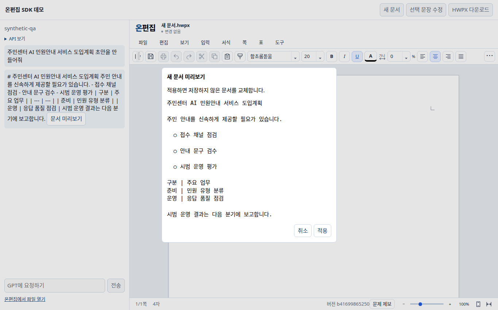
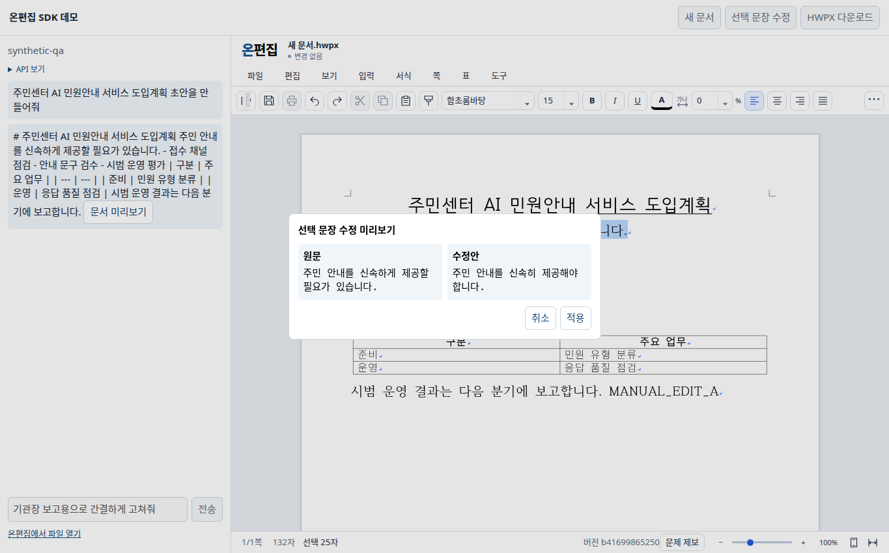
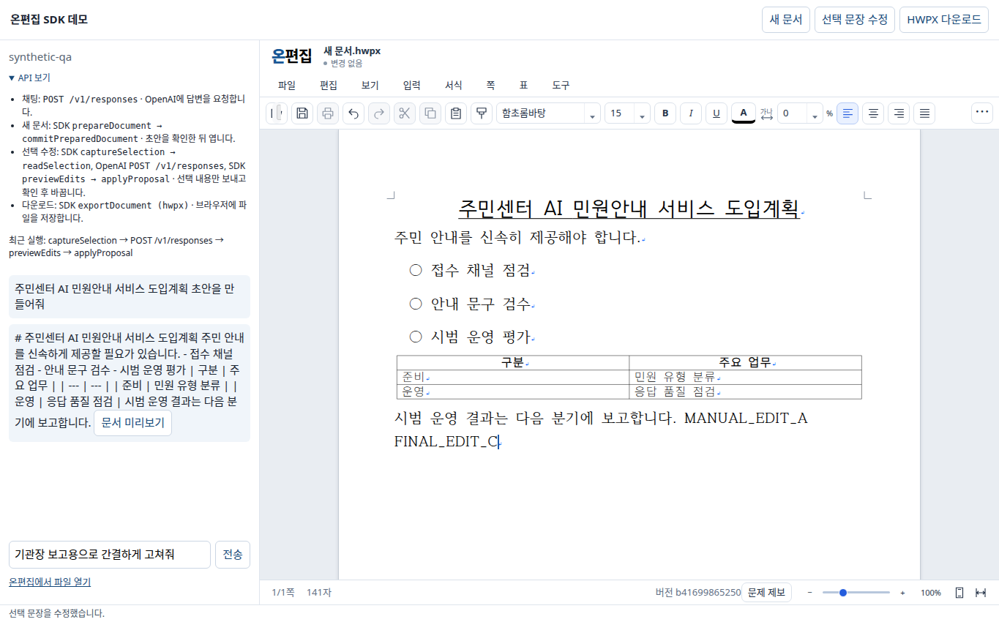
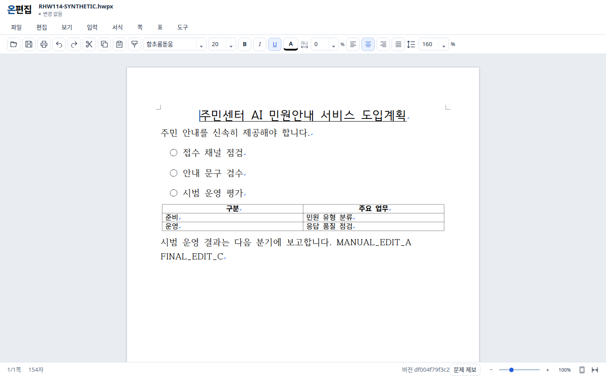

# 온편집 (Onedit)

**브라우저 기반 HWP/HWPX 문서 편집기 · JavaScript Host SDK**

*Browser-based HWP/HWPX editor with a JavaScript SDK for document workflows.*

[](https://github.com/wavelen-jw/onedit/releases/tag/v1.0.0-rc2)
[](LICENSE)
[](BUILDING-PUBLIC.md)

온편집은 **HWP/HWPX 문서를 브라우저에서 열고 편집**할 수 있는 웹 편집기입니다. 독립형으로 실행하거나, 별도 제공되는 **Host SDK**를 통해 문서 초안 생성과 선택 영역 수정·검토·적용을 외부 애플리케이션에 연결할 수 있습니다.

> [!NOTE]
> **Built on [RHWP](https://github.com/edwardkim/rhwp).** 온편집의 문서 처리 Core는 **Edward Kim 님과 RHWP 기여자들이 공개한 프로젝트**를 기반으로 합니다. 이 중요한 오픈소스 기반을 만들어 공유해 주신 모든 분들께 진심으로 감사드립니다.
>
> **RHWP 원본 GitHub:** <https://github.com/edwardkim/rhwp>

> [!IMPORTANT]
> 현재 공개 버전은 **[v1.0.0-rc2 (Pre-release)](https://github.com/wavelen-jw/onedit/releases/tag/v1.0.0-rc2)**입니다. HWP/HWPX의 모든 문서·서식 호환성을 보장하지 않으며, 운영 환경의 인증·권한 서비스 또는 TLS 서버는 제공하지 않습니다. 지원 범위는 [SDK 지원표](sdk/SUPPORT_MATRIX.md)를 확인하세요.

## 주요 기능

- **웹 문서 편집:** 지원 범위 내 HWP5/HWPX 문서 열기, 편집, Undo/Redo 및 HWPX 내보내기
- **문서 생성:** Host SDK를 통한 Markdown·DocumentSpec 기반 초안 생성, 미리보기 및 승인 후 반영
- **선택 영역 수정:** 선택 내용 고정, 수정안 미리보기, 사용자 검토 후 적용
- **Host SDK:** JavaScript/TypeScript용 20개 메서드·8개 이벤트, 명시적인 origin·세션·권한 검증
- **독립 실행:** Core WebAssembly(WASM)를 포함하는 실행 패키지로 로컬 실행 가능. 별도의 온라인 SDK 서버 불필요

## AI 문서 작성·수정 시나리오

온편집 SDK와 GPT를 연결한 [AI 테스트 웹](https://edit.govpress.cloud/ai)에서 **문서 초안 생성 → 사용자 편집 → 선택 문장 AI 재작성 → 최종 HWPX 저장**을 시연할 수 있습니다. AI는 문서 내용을 생성하고, 온편집 Host SDK는 미리보기·승인·부분 수정·내보내기를 수행합니다.

> [!NOTE]
> 아래 화면은 **2026-11-14에 실제 온편집 브라우저에서 시험용 문서와 합성 GPT 응답으로 재현한 캡처**입니다. 이미지 생성으로 만든 목업이 아니며, 당시 별도 진행한 **실제 GPT 연속 호출 시험의 원본 캡처는 아닙니다**. AI 테스트 웹의 호스팅·모델 연결은 공개 SDK 설치 패키지에 포함되지 않습니다.

### 처음부터 마지막 수정까지

| 단계 | 사용자 작업 | AI·SDK 처리 및 확인 사항 |
| --- | --- | --- |
| 1. 시작 | 테스트 웹 접속 후 **새 문서** 선택 | Host SDK 연결 및 새 작업본 생성 |
| 2. 초안 생성 | “주민센터 AI 민원안내 서비스 도입계획 초안을 만들어줘” 요청 | GPT가 제목·본문·3개 글머리표·2열×3행 표 생성 |
| 3. 미리보기·승인 | 생성된 초안을 확인하고 **적용** 선택 | `prepareDocument` → `commitPreparedDocument`; 승인 전 문서 불변 |
| 4. 직접 편집 | 본문에 문장을 추가하고 Undo/Redo | 일반 편집, 기존 문단·표 보존 |
| 5. 선택 문장 AI 수정 | 한 문장을 선택하고 “기관장 보고용으로 간결하게 고쳐줘” 요청 | `captureSelection` → `readSelection` → GPT Responses API → `previewEdits` |
| 6. 수정안 적용 | 원문과 수정안을 비교한 뒤 **적용** 선택 | `applyProposal`; 선택 영역만 교체, 다른 문단·표 유지 |
| 7. 최종 수정·저장 | 마지막 문장을 직접 수정하고 HWPX 다운로드 | Undo/Redo 확인 → `exportDocument` → 별도 편집기에서 재열기 |

**취소·오류 동작:** 미리보기 취소 시 원문을 유지하고, 빈 선택에서는 GPT 요청을 보내지 않습니다. GPT 응답 대기 중 문서가 변경되어 이전 선택이 무효가 되면 적용을 거부합니다. 최초 빈 작업본은 초안 승인 시 새 문서 인스턴스로 교체되며, 그 이후부터 최종 내보내기까지 동일한 작업본을 유지합니다.

### 시나리오 화면

#### 1. AI 문서 초안 미리보기


생성된 문서를 실제 편집기에 적용하기 전, 제목·본문·목록·표를 검토합니다.

#### 2. 선택 문장 재작성 미리보기


사용자가 선택한 문장만 AI 재작성 대상으로 전달하고, 원문과 수정안을 나란히 확인한 후 적용합니다.

#### 3. 최종 문서와 API 보기


AI 수정 이후에도 일반 편집을 계속할 수 있습니다. 왼쪽의 **API 보기**에서 GPT의 `POST /v1/responses`와 온편집 SDK의 문서 생성·선택 수정·내보내기 API를 구분해 확인할 수 있습니다. `MANUAL_EDIT_A`와 `FINAL_EDIT_C`는 시험에서 직접 편집 내용의 보존 여부를 확인하기 위한 표식입니다.

#### 4. 최종 HWPX 별도 재열기


HWPX를 다운로드한 뒤 독립 편집기에서 다시 열어, AI가 작성한 내용·직접 수정한 문장·표가 남아 있는지 확인합니다.

### 검증 범위

2026-11-14 기준 **실제 GPT 2회(초안 생성 1회·선택 문장 수정 1회)와 실제 SDK를 연결한 단일 세션 시험에서 12/12 항목이 통과**했습니다. 별도로 합성 GPT 응답을 사용한 SDK 연속 시나리오도 독립 검증했으며, 이 화면 캡처는 해당 **재현 시험**에 해당합니다. 실제 GPT 시험에서 내보낸 HWPX의 ZIP CRC·section XML과 독립 재열기를 확인했습니다.

이 결과는 지정된 합성 문서·브라우저 범위의 검증이며, 모든 HWPX 서식이나 모바일 기기의 호환성을 보증하지 않습니다. 화면의 글머리표 3개는 자동 목록 기능이 아닌 글머리표 문자입니다.

## 빠른 시작

**준비물:** Node.js 22 이상, 최신 Chromium 계열 브라우저 권장

[Releases](https://github.com/wavelen-jw/onedit/releases/tag/v1.0.0-rc2)에서 `onedit-browser-runtime.tar.gz`를 받은 후 파일 무결성을 확인하고 실행합니다.

```bash
# 1. 실행 패키지 다운로드
curl -fLO https://github.com/wavelen-jw/onedit/releases/download/v1.0.0-rc2/onedit-browser-runtime.tar.gz

# 2. v1.0.0-rc2 실행 패키지 SHA-256 검증
echo "64fb76498f42607e5151febb341c74c0dd4be8a0e9a914a09dcca5db174a60bd  onedit-browser-runtime.tar.gz" | sha256sum -c -

# 3. 압축 해제 및 로컬 실행
mkdir -p onedit-runtime
tar -xzf onedit-browser-runtime.tar.gz -C onedit-runtime
cd onedit-runtime
node start-ai-editor.mjs 4173
```

브라우저에서 **http://127.0.0.1:4173/** 을 엽니다. Windows에서는 SHA 확인에 `Get-FileHash`를 사용할 수 있습니다.

> 실행 패키지에는 편집기 자산과 Core WASM·JavaScript 바인딩이 포함됩니다. 이 저장소의 앱 소스만 내려받는 것으로는 동일한 실행 패키지가 완성되지 않습니다.

## JavaScript Host SDK

Host SDK는 **별도 npm 레지스트리에 게시하지 않고**, 동일한 릴리스의 설치 파일로 제공합니다.

```bash
curl -fLO https://github.com/wavelen-jw/onedit/releases/download/v1.0.0-rc2/onedit-ai-host-sdk-1.0.0-rc2.tgz
npm install --ignore-scripts ./onedit-ai-host-sdk-1.0.0-rc2.tgz
```

```ts
import { OneditHostClient } from "onedit-ai-host-sdk";

// iframe, editorOrigin 및 sessionProof는 신뢰할 수 있는 Host가 준비해야 합니다.
const client = await OneditHostClient.connect(iframe, editorOrigin, {
  sessionProof,
  checkedOpen: true,
  permissions: ["read", "edit", "lifecycle", "save"],
});

const capabilities = await client.request("getCapabilities", {});
console.log(capabilities.methods);
```

SDK 연결은 자동으로 허용되지 않습니다. 편집기의 **정확한 부모 origin·CSP·권한 정책**과 Host가 발급하는 승인 정보가 필요합니다. 예제에서 사용하는 검토·승인 방식은 로컬 실습용이며, 실제 운영 서비스의 인증을 대신하지 않습니다.

- [SDK 빠른 시작 및 로컬 예제](sdk/QUICKSTART.md)
- [API Reference](sdk/API_REFERENCE.md)
- [SDK 지원 범위](sdk/SUPPORT_MATRIX.md)
- [보안 경계](sdk/SECURITY_NOTES.md)

## 지원 형식과 제한사항

| 항목 | v1.0.0-rc2 범위 |
| --- | --- |
| HWP5 열기 | 검증된 일부 본문 문서 및 지원 구조 |
| HWPX 열기 | 검증된 일부 본문·일반 표/셀 문서 |
| 문서 생성 | Markdown, DocumentSpec의 지원 구조 |
| 선택 수정 | 단일 본문 문단 또는 최상위 일반 셀의 일부 등 제한된 범위 |
| 문서 내보내기 | **HWPX** |
| HWP 동일 형식 재저장 / SWP | 미지원 |
| 암호·DRM·모든 복합 문서 | 지원 또는 동일 조판 보장 없음 |

HWP 원본 파일을 덮어쓰지 않으며, HWPX 내보내기 결과는 사용 중인 글꼴과 문서 구조에 따라 원본과 차이가 날 수 있습니다. 자세한 제한·오류·입력 크기는 [API Reference](sdk/API_REFERENCE.md)를 참고하세요.

## 소스 빌드

소스에서 UI와 SDK를 다시 빌드하려면 **Node.js 22.23.1 / npm 10.9.8** 및 동일 버전의 실행 패키지를 준비합니다.

```bash
npm ci --ignore-scripts --no-audit --no-fund
node scripts/replay-public-release.mjs ../onedit-runtime

npm --prefix sdk run build
npm --prefix sdk run verify:release
npm --prefix sdk test
```

`../onedit-runtime`은 앞에서 압축을 해제한 실제 실행 패키지 경로로 변경하세요. 공개 소스로 **UI·SDK 빌드를 재검증**할 수 있지만, Core는 별도 제공되는 컴파일된 WASM을 사용하며 수정된 다운스트림 Rust 원본은 포함하지 않습니다.

[전체 빌드 가이드](BUILDING-PUBLIC.md) · [Core 바이너리 출처](CORE-BUILD-PROVENANCE.md)

## 배포 파일

[**v1.0.0-rc2 다운로드**](https://github.com/wavelen-jw/onedit/releases/tag/v1.0.0-rc2)

| 파일 | 내용 |
| --- | --- |
| `onedit-browser-runtime.tar.gz` | 독립 실행형 편집기, Core WASM, 브라우저 자산 |
| `onedit-app-source.tar.gz` | 공개 앱 소스 |
| `onedit-ai-host-sdk-1.0.0-rc2.tgz` | 설치 가능한 Host SDK |
| `onedit-core-binary.tar.gz` | Core 바이너리·바인딩·라이선스·출처 자료 |
| `onedit-release-documentation.tar.gz` | 빌드·라이선스·검증 문서 |
| `RELEASE-NOTES.md` | 릴리스 변경·실행 안내 |
| `SHA256SUMS` | 배포 구성요소 체크섬 |

다운로드한 파일의 해시는 [릴리스 안내](https://github.com/wavelen-jw/onedit/releases/tag/v1.0.0-rc2)와 문서 아카이브의 체크섬 정보를 기준으로 확인하세요.

## RHWP 프로젝트에 대한 감사 (Acknowledgements)

온편집은 **[RHWP (edwardkim/rhwp)](https://github.com/edwardkim/rhwp)**를 기반으로 개발되었습니다. HWP/HWPX 문서 형식을 처리하는 기반 기술을 오픈소스로 구현하고 공개한 RHWP의 기여는 온편집의 출발점이자 핵심 토대입니다.

**RHWP의 원 개발자 [Edward Kim](https://github.com/edwardkim) 님과 모든 기여자분들께 깊이 감사드립니다.** 복잡한 문서 처리 기술을 공개하고 발전시켜 주신 덕분에 온편집은 그 위에서 브라우저 편집 환경과 Host SDK 등 새로운 기능을 구현할 수 있었습니다.

온편집에 포함된 Core는 RHWP 원본을 그대로 배포한 것이 아니라, **RHWP를 기반으로 수정한 다운스트림 WebAssembly 빌드**입니다. 원 프로젝트와 온편집의 개발 범위는 구분하며, RHWP의 저작권 및 MIT 라이선스 고지를 존중하고 유지합니다.

- **RHWP 원본 프로젝트:** <https://github.com/edwardkim/rhwp>
- **Core 저작권·라이선스:** [THIRD_PARTY_CORE_NOTICE.md](THIRD_PARTY_CORE_NOTICE.md)
- **빌드 출처 및 변경된 Core의 관계:** [CORE-BUILD-PROVENANCE.md](CORE-BUILD-PROVENANCE.md)

## 라이선스

**온편집 자체 앱 소스와 Host SDK는 [MIT License](LICENSE)**를 따릅니다. 다만 배포 패키지의 모든 파일에 MIT가 일괄 적용되는 것은 아닙니다.

- **Core:** RHWP 기반의 수정된 컴파일 바이너리. 원 저작자의 MIT 고지 및 종속 구성요소 라이선스 유지
- **Noto 글꼴:** SIL Open Font License 1.1
- **함초롬바탕·함초롬돋움(HCR):** 한컴 별도 이용 조건. 이 공개 패키지는 **비상업적 재배포 조건**에 따르며, 상업적 글꼴 재배포·수정 권한을 부여하지 않음

MIT에 따른 소스코드 상업적 이용과 HCR 글꼴의 재배포 권한은 별개입니다. 상업적 배포 시 HCR 파일을 제외하거나 별도 허락을 받아야 합니다.

[전체 제3자 고지](THIRD_PARTY_NOTICES.md) · [Core 고지](THIRD_PARTY_CORE_NOTICE.md)

## 이슈 및 기여

버그나 개선 제안은 [GitHub Issues](https://github.com/wavelen-jw/onedit/issues)에 남겨 주세요. 재현 가능한 최소 단계, 브라우저·운영체제, 온편집 버전, 입력 형식을 함께 적으면 도움이 됩니다. 실제 업무 문서·개인정보·접근 토큰이나 비밀키는 공개 이슈에 첨부하지 마세요.

---

**Onedit** · [Release](https://github.com/wavelen-jw/onedit/releases/tag/v1.0.0-rc2) · [SDK API](sdk/API_REFERENCE.md) · [License](LICENSE)
