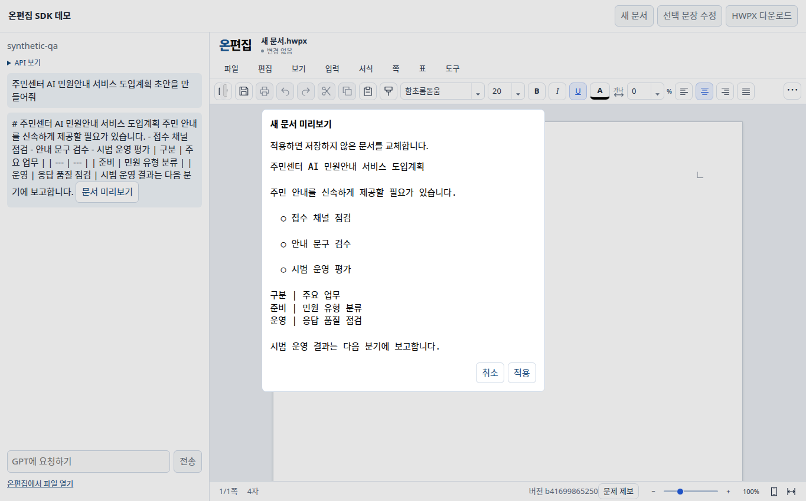
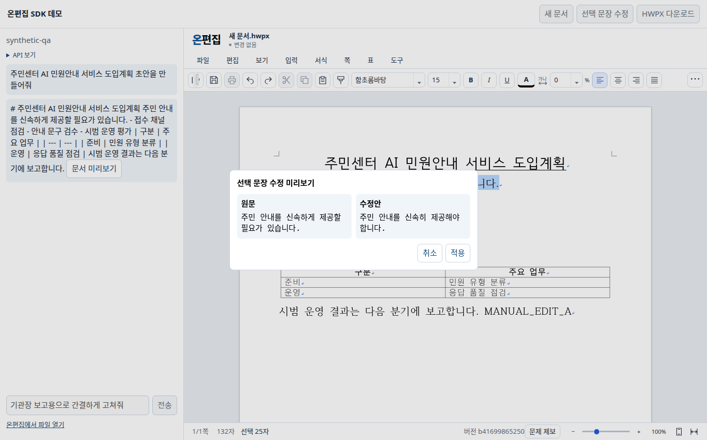
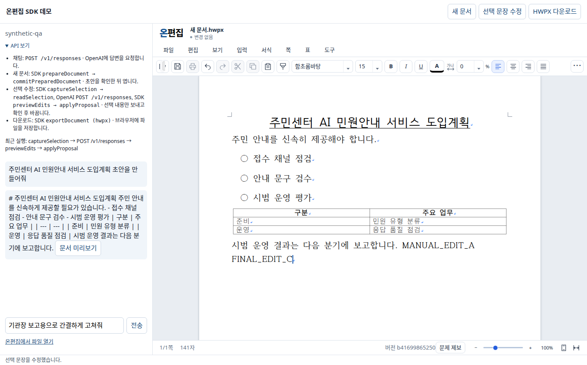
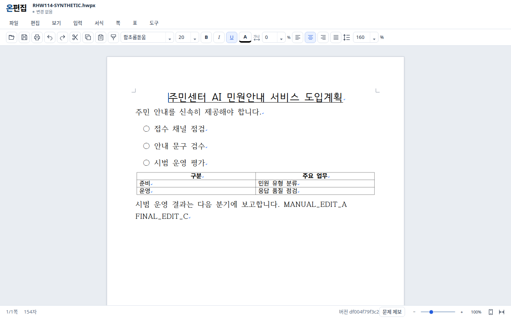

# 온편집 (Onedit)

**브라우저 기반 HWP/HWPX 문서 편집기 · JavaScript/TypeScript Host SDK**  
*Browser-based Korean document editor with an embeddable Host SDK.*

[](https://github.com/wavelen-jw/onedit/releases/tag/v1.0.0-rc5)
[](LICENSE)
[](BUILDING-PUBLIC.md)

온편집은 웹브라우저에서 **HWP5/HWPX 문서를 열고, 편집한 결과를 HWPX로 저장**할 수 있는 프로젝트입니다. 독립 실행형 편집기와 외부 서비스에 연결할 수 있는 Host SDK를 제공합니다.

**[온라인 편집기](https://edit.govpress.cloud/) · [AI 연동 데모](https://edit.govpress.cloud/ai) · [v1.0.0-rc5 다운로드](https://github.com/wavelen-jw/onedit/releases/tag/v1.0.0-rc5) · [SDK 문서](sdk/QUICKSTART.md)**

> [!IMPORTANT]
> **v1.0.0-rc5는 Pre-release입니다.** 공개 배포본에는 **운영용 AI 모델 API, 인증 서버, 비밀키 또는 TLS 서비스**가 포함되지 않습니다.

## 주요 기능

| 영역 | 제공 기능 |
| --- | --- |
| 문서 열기 | 지원 범위 내 HWP5, HWPX 파일 불러오기 |
| 문서 편집 | 본문·일반 표/셀 편집, 선택·서식 조정, 실행 취소/다시 실행 |
| 문서 생성 | Markdown·DocumentSpec 가져오기, 제목 번호와 보고서 서식 변환 |
| 문서 내보내기 | **HWPX**로 다운로드, 파일 무결성 및 재열기 확인 |
| Host SDK | 검사를 거친 문서 열기, 초안 생성, 선택 수정안 미리보기·승인·적용, HWPX 내보내기 |
| 독립 실행 | 브라우저 자산과 Core WebAssembly를 포함하는 로컬 실행 패키지 |

공개 SDK는 **20개 메서드·8개 이벤트**의 v1 인터페이스를 제공합니다. 문서 생성·선택 수정의 상세 지원 조건은 [API Reference](sdk/API_REFERENCE.md)와 [지원 범위](sdk/SUPPORT_MATRIX.md)를 확인하세요.

## 빠른 시작

**요구 환경:** Node.js 22 이상(릴리스 검증 환경: Node.js 22.23.1), Chromium 계열 브라우저 권장.

[GitHub Releases](https://github.com/wavelen-jw/onedit/releases/tag/v1.0.0-rc5)에서 독립 실행 패키지를 내려받습니다.

```bash
curl -fLO https://github.com/wavelen-jw/onedit/releases/download/v1.0.0-rc5/onedit-browser-runtime.tar.gz
curl -fLO https://github.com/wavelen-jw/onedit/releases/download/v1.0.0-rc5/SHA256SUMS

# 다운로드한 파일의 체크섬 확인 (GNU coreutils)
sha256sum --check --ignore-missing SHA256SUMS

mkdir -p onedit-runtime
tar -xzf onedit-browser-runtime.tar.gz -C onedit-runtime
cd onedit-runtime
node start-ai-editor.mjs 4173
```

브라우저에서 **http://127.0.0.1:4173/** 을 엽니다. macOS에서는 `shasum -a 256`, Windows에서는 `Get-FileHash`로 체크섬을 확인할 수 있습니다.

> 독립 실행형 편집은 별도 AI 서버 없이 사용할 수 있습니다. 위 실행 패키지는 공개 앱 소스와 달리 **컴파일된 Core WASM·바인딩·글꼴 자산**을 함께 포함합니다.

## Host SDK

Host SDK는 별도 npm 레지스트리가 아닌 **이 저장소의 릴리스 설치 파일**로 배포합니다.

```bash
curl -fLO https://github.com/wavelen-jw/onedit/releases/download/v1.0.0-rc5/onedit-ai-host-sdk-1.0.0-rc5.tgz
npm install --ignore-scripts ./onedit-ai-host-sdk-1.0.0-rc5.tgz
```

```ts
import { OneditHostClient } from "onedit-ai-host-sdk";

// iframe, editorOrigin, sessionProof는 신뢰된 Host가 제공해야 합니다.
const client = await OneditHostClient.connect(iframe, editorOrigin, {
  sessionProof,
  checkedOpen: true,
  permissions: ["read", "edit", "lifecycle", "save"],
});

const capabilities = await client.request("getCapabilities", {});
console.log(capabilities.methods);
```

| 작업 | SDK 흐름 |
| --- | --- |
| 기존 파일 편집 | `openDocument` → 브라우저 편집 → `exportDocument({ format: "hwpx" })` |
| Markdown·DocumentSpec으로 새 문서 작성 | `prepareDocument` → 미리보기·승인 → `commitPreparedDocument` |
| 선택 영역 수정 | `captureSelection` → `readSelection` → `previewEdits` → 승인 후 `applyProposal` |

외부 HWPX 열기를 연결하기 전에 `getCapabilities()`에서 `formats.open`에 `hwpx`가 있는지, `openPolicy.availability`가 `guarded`인지 확인하세요. 파일 열기에는 Host가 승인한 파일 메타데이터와 작업본 정보가 필요합니다.

SDK는 편집기 iframe이나 사용자를 자동으로 인증하지 않습니다. 로컬 예제는 루프백에서 실행됩니다. HTTPS 서비스에서 파일 열기를 허용하려면 Host와 편집기를 같은 HTTPS origin에 두고, 편집기와 SDK 양쪽의 `checkedOpen`, CSP, session proof 및 권한 정책을 구성하세요. 실행 패키지의 `AI-BROWSER-CHANNEL.md`에 설정 방식이 나와 있습니다.

- [SDK 빠른 시작과 로컬 예제](sdk/QUICKSTART.md)
- [API Reference](sdk/API_REFERENCE.md)
- [지원 기능·제약](sdk/SUPPORT_MATRIX.md)
- [보안 경계](sdk/SECURITY_NOTES.md)

## AI 연동 데모

[온편집 AI 테스트 웹](https://edit.govpress.cloud/ai/)은 초대 코드로 접속하는 호스팅 데모입니다. 선택한 HWPX는 열기 승인 후 브라우저 안의 편집기에 열립니다. 보고서 작성과 선택 영역 재작성은 별도 운영 서버의 AI를 사용합니다. 공개 설치 패키지에 AI 서버나 인증 정보는 포함되지 않습니다.

보고서 작성 흐름은 다음과 같습니다.

1. **내용 작성:** 자연어 요청에 따라 1차 원고를 작성합니다. 정해진 목차 양식은 요구하지 않습니다.
2. **서식 정리:** 별도 AI 호출로 2차 GFM을 만듭니다. 각 단계와 SDK 호출은 왼쪽 **처리 과정 및 호출 API** 목록에 나타납니다.
3. **미리보기·적용:** 2차 GFM을 일반 Markdown 가져오기와 같은 조판 경로로 미리 보고, 승인 후 문서에 적용합니다. 2차 작성이 실패하면 1차 원고를 문서에 자동 적용하지 않습니다.
4. **저장:** 편집한 결과를 HWPX로 내려받습니다.

선택 문장을 AI로 다시 작성하는 흐름은 보고서 전체 생성과 구분되며, **선택 영역만 미리보기·승인 후 수정**합니다.

<details>
<summary>AI 문서 생성·선택 수정 시나리오 화면 보기</summary>

아래는 **2026-11-14의 합성 GPT 응답을 사용한 브라우저 검증 화면**입니다. 최신 서비스 화면과 일부 다를 수 있으며 실제 모델 호출 화면을 의미하지 않습니다.

**초안 미리보기·승인**



**선택 문장 재작성·검토**



**편집 후 최종 문서**



**내보낸 HWPX 별도 재열기**



</details>

## 소스 빌드

정확한 재현을 위해 [RC5 태그의 소스](https://github.com/wavelen-jw/onedit/tree/v1.0.0-rc5)와 같은 버전의 실행 패키지를 함께 사용하세요. 검증에 사용한 버전은 **Node.js 22.23.1 / npm 10.9.8**입니다.

```bash
npm ci --ignore-scripts --no-audit --no-fund
node scripts/replay-public-release.mjs ../onedit-runtime

npm --prefix sdk run build
npm --prefix sdk run verify:release
npm --prefix sdk test
```

`../onedit-runtime`은 위에서 내려받아 압축을 해제한 실행 패키지 디렉터리입니다. 이 빌드는 공개 App·SDK 소스와 제공된 Core 바이너리를 사용하며, **수정된 다운스트림 Rust Core 원본을 재빌드하지 않습니다.**

자세한 내용: [빌드 가이드](BUILDING-PUBLIC.md) · [Core 바이너리 출처](CORE-BUILD-PROVENANCE.md)

## 배포 파일 — v1.0.0-rc5

| 파일 | 용도 |
| --- | --- |
| `onedit-browser-runtime.tar.gz` | 실행형 편집기·Core WASM·브라우저 자산 |
| `onedit-app-source.tar.gz` | 공개 App 소스 |
| `onedit-ai-host-sdk-1.0.0-rc5.tgz` | Host SDK 설치 패키지 |
| `onedit-core-binary.tar.gz` | Core 바이너리·바인딩 및 고지 |
| `onedit-release-documentation.tar.gz` | 빌드·출처·라이선스 문서 |
| `RELEASE-NOTES.md` | 버전 변경 사항 |
| `SHA256SUMS` | 배포 파일 체크섬 |

**[v1.0.0-rc5 릴리스 및 다운로드](https://github.com/wavelen-jw/onedit/releases/tag/v1.0.0-rc5)**

## RHWP에 대한 감사

**온편집은 [RHWP](https://github.com/edwardkim/rhwp)를 기반으로 개발되었습니다.** HWP/HWPX 문서 처리 기술을 오픈소스로 구현하고 공개해 주신 **[Edward Kim](https://github.com/edwardkim) 님과 RHWP의 모든 기여자분들께 깊이 감사드립니다.**

RHWP의 공개 Core 덕분에 온편집은 웹 문서 편집 환경과 외부 서비스를 연결하는 Host SDK를 개발할 수 있었습니다. 온편집이 배포하는 Core는 **RHWP를 기반으로 수정된 다운스트림 WebAssembly 빌드**이며, RHWP 원저작자의 권리와 라이선스 고지를 유지합니다.

- [RHWP 원본](https://github.com/edwardkim/rhwp)
- [Core 저작권 및 라이선스](THIRD_PARTY_CORE_NOTICE.md)
- [Core 빌드 출처](CORE-BUILD-PROVENANCE.md)

## 라이선스

온편집이 직접 개발한 App 소스 및 Host SDK는 **[MIT License](LICENSE)**를 따릅니다. 다만 공개 배포물 전체에 MIT가 일괄 적용되는 것은 아닙니다.

- **RHWP 기반 Core:** 원 프로젝트 및 종속 구성요소 라이선스 유지
- **Noto 글꼴:** SIL Open Font License 1.1 등 해당 고지 적용
- **함초롬바탕·함초롬돋움(HCR):** 한컴의 별도 조건 적용. 상업적 글꼴 재배포에는 별도 허락이 필요할 수 있으며, MIT 라이선스만으로 허용되지 않습니다.

상업적으로 재배포할 때는 글꼴 및 포함 자산의 조건을 각각 확인하세요. [제3자 고지](THIRD_PARTY_NOTICES.md) · [Core 고지](THIRD_PARTY_CORE_NOTICE.md)

---

[릴리스](https://github.com/wavelen-jw/onedit/releases/tag/v1.0.0-rc5) · [SDK API](sdk/API_REFERENCE.md) · [빌드](BUILDING-PUBLIC.md) · [라이선스](LICENSE)
